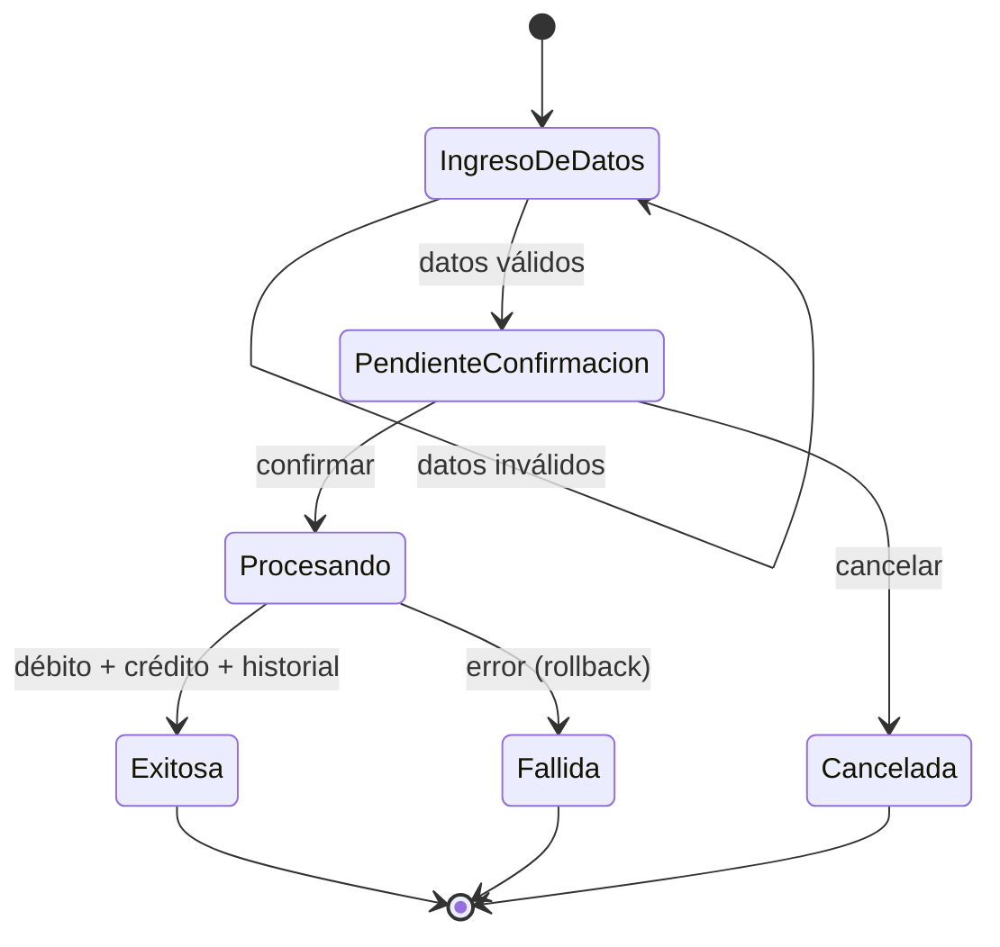

# MakersPay — Módulo funcional: estrategia, diseño de pruebas y reporte de bugs

> Funcionalidad bajo prueba: **un usuario autenticado envía dinero a otro usuario registrado usando su número de celular.**
> La matriz de casos ejecutable está en [`MakersPay-matriz-de-pruebas.xlsx`](MakersPay-matriz-de-pruebas.xlsx).

## Contenido

1. [Análisis del requerimiento](#1-análisis-del-requerimiento)
2. [Alcance](#2-alcance)
3. [Supuestos y preguntas al PO](#3-supuestos-y-preguntas-al-po)
4. [Análisis de riesgos](#4-análisis-de-riesgos)
5. [Técnicas de prueba](#5-técnicas-de-prueba)
6. [Tipos de prueba](#6-tipos-de-prueba)
7. [Diseño con técnicas](#7-diseño-con-técnicas)
8. [Escenarios de prueba](#8-escenarios-de-prueba)
9. [Casos de prueba](#9-casos-de-prueba)
10. [Escenarios BDD (Gherkin)](#10-escenarios-bdd-gherkin)
11. [Trazabilidad](#11-trazabilidad)
12. [Reporte de bugs](#12-reporte-de-bugs)
13. [Criterios de entrada y salida](#13-criterios-de-entrada-y-salida)
14. [Propuesta de automatización](#14-propuesta-de-automatización)

## 1. Análisis del requerimiento

Reglas de negocio identificadas (base de la trazabilidad):

| ID | Regla de negocio |
|---|---|
| RN-01 | Usuario autenticado puede enviar dinero |
| RN-02 | Monto mínimo $5.000 |
| RN-03 | Monto máximo $2.000.000 |
| RN-04 | No enviar más del saldo disponible |
| RN-05 | No enviar al mismo número |
| RN-06 | Destinatario registrado |
| RN-07 | Éxito: se descuenta saldo del remitente |
| RN-08 | Éxito: se incrementa saldo del destinatario |
| RN-09 | Éxito: movimiento en historial de ambos |
| RN-10 | Falla: mensaje claro y saldo sin afectar |

## 2. Alcance

**Dentro del alcance:** inicio de sesión, consulta de saldo, envío de dinero por número de celular, validaciones de negocio, afectación de saldos e historial, manejo de errores, seguridad básica del flujo y concurrencia.

**Fuera del alcance:** registro de usuarios, recargas/retiros, notificaciones push/SMS, límites acumulados diarios, conciliación contable y pruebas de carga a gran escala.

## 3. Supuestos y preguntas al PO

El requerimiento deja puntos abiertos. Se documenta el supuesto con el que se diseñó cada caso y la pregunta que debe resolver el Product Owner antes de ejecutar:

| ID | Supuesto de diseño | Pregunta al PO |
|---|---|---|
| S-01 | Los límites son inclusivos: $5.000 y $2.000.000 son montos válidos. | ¿Confirmar que los límites son inclusivos (≥ 5.000 y ≤ 2.000.000)? |
| S-02 | El monto se ingresa en pesos enteros (COP no maneja centavos en la app). | ¿Se permiten decimales? ¿Qué separador de miles se acepta? |
| S-03 | El celular es colombiano: 10 dígitos, inicia en 3. Se normalizan espacios y el prefijo +57. | ¿Se acepta +57 / espacios / guiones? ¿Se normalizan antes de validar? |
| S-04 | El envío no tiene comisión: el remitente se debita exactamente el monto enviado. | ¿Existe comisión o GMF (4x1000) que deba descontarse? |
| S-05 | Existe una pantalla de confirmación antes de ejecutar el envío. | ¿Hay confirmación, OTP o PIN antes de enviar? |
| S-06 | Si fallan varias reglas a la vez, se muestra el primer error en este orden: destinatario → monto → saldo. | ¿Cuál es el orden de prioridad de los mensajes de error? |
| S-07 | No hay límite diario/mensual acumulado (fuera del requerimiento). | ¿Existe tope diario o mensual por usuario? |

## 4. Análisis de riesgos

La priorización de los casos sigue el riesgo (probabilidad × impacto). En una billetera digital el mayor riesgo es perder o duplicar dinero, por eso concurrencia, atomicidad y fronteras de monto van primero.

| Riesgo | Probabilidad | Impacto | Casos que lo mitigan |
|---|---|---|---|
| Doble débito o saldo negativo por concurrencia | Alta | Crítico | CP-25, CP-26 |
| Error de frontera (< vs ≤) en límites de monto | Alta | Alto | CP-05 a CP-10 |
| Débito sin crédito (transacción no atómica) | Media | Crítico | CP-24 |
| Validaciones solo en el front (bypass por API) | Media | Crítico | CP-15, CP-27, CP-28 |
| Auto-envío con número en otro formato | Media | Medio | CP-18 |
| Mensajes de error poco claros | Alta | Medio | CP-31 |

## 5. Técnicas de prueba

| Técnica | Categoría | Cómo se aplica | Dónde |
|---|---|---|---|
| Partición de equivalencia | Caja negra | Dividir monto, saldo y celular en clases válidas e inválidas para probar un representante de cada una. | Monto, celular destino, saldo |
| Análisis de valores límite (3 valores) | Caja negra | Probar justo antes, en y justo después de cada frontera ($5.000, $2.000.000 y saldo disponible), donde se concentran los errores de < vs ≤. | Monto mínimo, máximo y saldo |
| Tabla de decisión | Caja negra | Combinar las 5 condiciones de negocio para garantizar que cada combinación tiene un resultado definido. | Reglas de negocio combinadas |
| Transición de estados | Caja negra | Validar el ciclo de vida de la transacción y que no existan transiciones inválidas (p. ej. reprocesar una transacción exitosa). | Ciclo de vida de la transacción |
| Casos de uso / escenarios E2E | Caja negra | Recorrer el flujo completo login → saldo → envío → historial desde la perspectiva del usuario. | Flujo principal y alternos |
| Adivinanza de errores (error guessing) | Basada en experiencia | Atacar puntos típicos de falla en billeteras: doble clic, concurrencia, montos negativos, manipulación de la petición. | Robustez y seguridad |
| Pruebas exploratorias por sesiones | Basada en experiencia | Sesiones de 60 min con charter (p. ej. 'Explorar envíos con saldo al límite') para descubrir lo que los casos no cubren. | Toda la funcionalidad |

## 6. Tipos de prueba

| Tipo | Categoría | Objetivo |
|---|---|---|
| Smoke | Funcional | Verificar en minutos que login, saldo y un envío básico funcionan tras cada despliegue. |
| Funcionales (positivas y negativas) | Funcional | Validar cada regla de negocio con datos válidos e inválidos. |
| Integración | Funcional | Verificar que el débito, el crédito y los dos registros de historial ocurren juntos (servicio de transacciones ↔ cuentas ↔ historial). |
| Regresión | Funcional | Re-ejecutar la suite (priorizada por riesgo) ante cada cambio; candidata a automatización. |
| API / contrato | Funcional | Validar el endpoint de transferencia directamente: códigos HTTP, esquema, validaciones del backend sin depender de la UI. |
| Seguridad | No funcional | Autenticación, autorización (IDOR), manipulación de parámetros, expiración de sesión. |
| Concurrencia / rendimiento | No funcional | Envíos simultáneos sobre el mismo saldo, idempotencia y tiempos de respuesta bajo carga. |
| Usabilidad y accesibilidad | No funcional | Mensajes de error claros, accionables y legibles por lectores de pantalla (WCAG 2.1 AA). |
| Compatibilidad | No funcional | Navegadores y dispositivos objetivo (Chrome, Safari, Android, iOS). |

## 7. Diseño con técnicas

### 7.1 Partición de equivalencia

| Variable | Clase | Tipo | Descripción | Valor representativo |
|---|---|---|---|---|
| Monto | CE-V1 | Válida | 5.000 ≤ monto ≤ 2.000.000 y monto ≤ saldo | 50.000 |
| Monto | CE-I1 | Inválida | monto < 5.000 | 4.999 / 1.000 |
| Monto | CE-I2 | Inválida | monto > 2.000.000 | 2.000.001 |
| Monto | CE-I3 | Inválida | monto > saldo disponible (dentro del rango) | saldo 80.000, monto 80.001 |
| Monto | CE-I4 | Inválida | monto = 0 o negativo | 0 / -10.000 |
| Monto | CE-I5 | Inválida | no numérico, decimales o vacío | 'abc' / 5000,50 / vacío |
| Celular destino | CE-V2 | Válida | 10 dígitos, inicia en 3, registrado y distinto al propio | 3104445566 |
| Celular destino | CE-I6 | Inválida | igual al número del remitente | 3001112233 |
| Celular destino | CE-I7 | Inválida | formato válido pero no registrado | 3209998877 |
| Celular destino | CE-I8 | Inválida | formato inválido (longitud, letras, no inicia en 3) | 310444556 / 31044455667 / 31O4445566 |
| Celular destino | CE-I9 | Inválida | vacío | — |
| Sesión | CE-V3 | Válida | usuario autenticado con sesión vigente | token válido |
| Sesión | CE-I10 | Inválida | sin sesión o sesión expirada | sin token / token vencido |

### 7.2 Análisis de valores límite

| Frontera | Valor | Resultado esperado | Caso |
|---|---|---|---|
| Monto mínimo | 4.999 | Rechazado | CP-06 |
| Monto mínimo | 5.000 | Exitoso | CP-05 |
| Monto mínimo | 5.001 | Exitoso | CP-07 |
| Monto máximo | 1.999.999 | Exitoso | CP-10 |
| Monto máximo | 2.000.000 | Exitoso | CP-08 |
| Monto máximo | 2.000.001 | Rechazado | CP-09 |
| Saldo disponible (saldo = 80.000) | 79.999 | Exitoso | CP-11 |
| Saldo disponible (saldo = 80.000) | 80.000 | Exitoso (saldo queda en 0) | CP-11 |
| Saldo disponible (saldo = 80.000) | 80.001 | Rechazado | CP-12 |

### 7.3 Tabla de decisión

S = se cumple · N = no se cumple · — = indiferente (la validación anterior ya detuvo el flujo, ver supuesto S-06).

| Condición / Acción | R1 | R2 | R3 | R4 | R5 | R6 | R7 |
|---|---|---|---|---|---|---|---|
| C1. Usuario autenticado | S | N | S | S | S | S | S |
| C2. Destinatario registrado | S | — | N | S | S | S | S |
| C3. Destinatario ≠ número propio | S | — | — | N | S | S | S |
| C4. Monto ≥ 5.000 | S | — | — | — | N | S | S |
| C5. Monto ≤ 2.000.000 | S | — | — | — | — | N | S |
| C6. Monto ≤ saldo disponible | S | — | — | — | — | — | N |
| **Resultado** | Envío exitoso: debita, acredita y registra historial en ambos | Redirige a login; no se procesa | Error: el número no está registrado | Error: no puedes enviarte dinero a ti mismo | Error: el monto mínimo es $5.000 | Error: el monto máximo es $2.000.000 | Error: saldo insuficiente |
| **Caso** | CP-04 | CP-03 | CP-19 | CP-18 | CP-06 | CP-09 | CP-12 |

### 7.4 Transición de estados de la transacción



| Estado origen | Evento | Estado destino | Transición |
|---|---|---|---|
| Ingreso de datos | Usuario confirma datos válidos | Pendiente de confirmación | Válida |
| Ingreso de datos | Datos inválidos | Ingreso de datos (con error) | Válida |
| Pendiente de confirmación | Usuario cancela | Cancelada | Válida |
| Pendiente de confirmación | Usuario confirma | Procesando | Válida |
| Procesando | Débito + crédito + historial OK | Exitosa | Válida |
| Procesando | Falla cualquier paso (rollback) | Fallida | Válida |
| Exitosa | Reintento / doble envío del mismo request | — (no debe reprocesar) | Inválida → probar en CP-25 |
| Fallida | Reintento automático | — (no debe quedar Exitosa sin nueva confirmación) | Inválida → probar en CP-24 |

## 8. Escenarios de prueba

| ID | Escenario | Prioridad | Casos |
|---|---|---|---|
| ESC-01 | Autenticación y consulta de saldo | Alta | CP-01, CP-02 |
| ESC-02 | Envío exitoso de dinero (flujo principal) | Alta | CP-04, CP-30 |
| ESC-03 | Validación del monto mínimo por transacción | Alta | CP-05, CP-06, CP-07, CP-14, CP-16 |
| ESC-04 | Validación del monto máximo por transacción | Alta | CP-08, CP-09, CP-10 |
| ESC-05 | Validación de saldo disponible | Alta | CP-11, CP-12, CP-13 |
| ESC-06 | Validación del destinatario (registrado, propio número, formato) | Alta | CP-17, CP-18, CP-19, CP-20 |
| ESC-07 | Integridad de saldos e historial de movimientos | Alta | CP-21, CP-22, CP-23 |
| ESC-08 | Atomicidad: una transacción fallida no afecta saldos | Alta | CP-24 |
| ESC-09 | Seguridad del envío | Alta | CP-03, CP-15, CP-27, CP-28, CP-29 |
| ESC-10 | Concurrencia e idempotencia | Alta | CP-25, CP-26 |
| ESC-11 | Usabilidad y accesibilidad de mensajes | Media | CP-31, CP-32 |

## 9. Casos de prueba

Datos base: **Laura (cel. 3001112233)** como remitente y **Pedro (cel. 3104445566)** como destinatario. Total: **32 casos** (20 alta, 11 media, 1 baja).

| ID | Escenario | Título | Técnica | Tipo | Prioridad |
|---|---|---|---|---|---|
| CP-01 | ESC-01 | Login exitoso y visualización del saldo | Casos de uso | Funcional / Smoke | Alta |
| CP-02 | ESC-01 | Login fallido con contraseña incorrecta | Partición de equivalencia | Funcional negativa | Alta |
| CP-03 | ESC-09 | Acceso al envío sin sesión activa | Tabla de decisión (R2) | Seguridad | Alta |
| CP-04 | ESC-02 | Envío exitoso con monto dentro del rango | Tabla de decisión (R1) | Funcional / Smoke / Integración | Alta |
| CP-05 | ESC-03 | Envío con monto igual al mínimo ($5.000) | Valores límite | Funcional | Alta |
| CP-06 | ESC-03 | Envío con monto inferior al mínimo ($4.999) | Valores límite / Tabla de decisión (R5) | Funcional negativa | Alta |
| CP-07 | ESC-03 | Envío con monto apenas superior al mínimo ($5.001) | Valores límite | Funcional | Media |
| CP-08 | ESC-04 | Envío con monto igual al máximo ($2.000.000) | Valores límite | Funcional | Alta |
| CP-09 | ESC-04 | Envío con monto superior al máximo ($2.000.001) | Valores límite / Tabla de decisión (R6) | Funcional negativa | Alta |
| CP-10 | ESC-04 | Envío con monto apenas inferior al máximo ($1.999.999) | Valores límite | Funcional | Media |
| CP-11 | ESC-05 | Envío de todo el saldo disponible | Valores límite | Funcional | Alta |
| CP-12 | ESC-05 | Envío superior al saldo disponible | Valores límite / Tabla de decisión (R7) | Funcional negativa | Alta |
| CP-13 | ESC-05 | Saldo inferior al monto mínimo | Partición de equivalencia | Funcional negativa | Media |
| CP-14 | ESC-03 | Monto en cero | Partición de equivalencia (CE-I4) | Funcional negativa | Media |
| CP-15 | ESC-09 | Monto negativo | Adivinanza de errores (CE-I4) | Funcional negativa / Seguridad | Alta |
| CP-16 | ESC-03 | Monto no numérico o con decimales | Partición de equivalencia (CE-I5) | Funcional negativa | Media |
| CP-17 | ESC-06 | Campos obligatorios vacíos | Partición de equivalencia (CE-I5, CE-I9) | Funcional negativa | Media |
| CP-18 | ESC-06 | Envío a su mismo número de celular | Tabla de decisión (R4) | Funcional negativa | Alta |
| CP-19 | ESC-06 | Envío a número no registrado | Tabla de decisión (R3) | Funcional negativa | Alta |
| CP-20 | ESC-06 | Celular destino con formato inválido | Partición de equivalencia (CE-I8) | Funcional negativa | Media |
| CP-21 | ESC-07 | Historial del remitente registra el débito | Casos de uso | Integración | Alta |
| CP-22 | ESC-07 | Historial del destinatario registra el crédito | Casos de uso | Integración | Alta |
| CP-23 | ESC-07 | Envíos consecutivos mantienen saldos correctos | Casos de uso | Regresión / Integración | Media |
| CP-24 | ESC-08 | Falla técnica durante el procesamiento (rollback) | Transición de estados | Integración / Robustez | Alta |
| CP-25 | ESC-10 | Doble clic / doble envío de la misma transacción | Adivinanza de errores / Transición de estados | Concurrencia | Alta |
| CP-26 | ESC-10 | Envíos simultáneos que en conjunto superan el saldo | Adivinanza de errores | Concurrencia | Alta |
| CP-27 | ESC-09 | Manipulación del monto en la petición | Adivinanza de errores | Seguridad / API | Alta |
| CP-28 | ESC-09 | Envío usando la cuenta de otro usuario (IDOR) | Adivinanza de errores | Seguridad / API | Alta |
| CP-29 | ESC-09 | Sesión expirada en la confirmación | Transición de estados | Seguridad | Media |
| CP-30 | ESC-02 | Cancelar en la pantalla de confirmación | Transición de estados | Funcional | Media |
| CP-31 | ESC-11 | Mensajes de error claros y accesibles | Exploratoria | Usabilidad / Accesibilidad | Media |
| CP-32 | ESC-11 | Formato de moneda y separadores | Exploratoria | Usabilidad | Baja |

### Detalle de los casos

#### CP-01 — Login exitoso y visualización del saldo

- **Escenario:** ESC-01 · **Prioridad:** Alta · **Técnica:** Casos de uso · **Tipo:** Funcional / Smoke
- **Precondiciones:** Laura (cel. 3001112233) registrada con saldo $1.000.000
- **Datos de prueba:** cel. 3001112233 / contraseña válida
- **Pasos:**
  1. Abrir MakersPay
  2. Ingresar celular y contraseña válidos
  3. Presionar 'Iniciar sesión'
- **Resultado esperado:** Ingresa al home y ve su saldo: $1.000.000 con formato de moneda COP.

#### CP-02 — Login fallido con contraseña incorrecta

- **Escenario:** ESC-01 · **Prioridad:** Alta · **Técnica:** Partición de equivalencia · **Tipo:** Funcional negativa
- **Precondiciones:** Laura (cel. 3001112233) registrada
- **Datos de prueba:** cel. 3001112233 / contraseña incorrecta
- **Pasos:**
  1. Ingresar celular válido y contraseña incorrecta
  2. Presionar 'Iniciar sesión'
- **Resultado esperado:** Mensaje genérico 'Credenciales inválidas' (sin revelar cuál dato falló). No se muestra saldo.

#### CP-03 — Acceso al envío sin sesión activa

- **Escenario:** ESC-09 · **Prioridad:** Alta · **Técnica:** Tabla de decisión (R2) · **Tipo:** Seguridad
- **Precondiciones:** Sin sesión iniciada
- **Datos de prueba:** URL/pantalla de envío
- **Pasos:**
  1. Intentar abrir directamente la pantalla/endpoint de envío
- **Resultado esperado:** Se redirige a login (UI) o responde 401 (API). No se procesa ninguna transacción.

#### CP-04 — Envío exitoso con monto dentro del rango

- **Escenario:** ESC-02 · **Prioridad:** Alta · **Técnica:** Tabla de decisión (R1) · **Tipo:** Funcional / Smoke / Integración
- **Precondiciones:** Laura (cel. 3001112233) saldo $1.000.000; Pedro (cel. 3104445566) saldo $200.000
- **Datos de prueba:** Destino 3104445566, monto $50.000
- **Pasos:**
  1. Iniciar sesión como Laura
  2. Ir a 'Enviar dinero'
  3. Ingresar celular 3104445566 y monto 50.000
  4. Confirmar el envío
- **Resultado esperado:** Mensaje de éxito con id de transacción. Saldo Laura = $950.000. Saldo Pedro = $250.000. Movimiento en el historial de ambos.

#### CP-05 — Envío con monto igual al mínimo ($5.000)

- **Escenario:** ESC-03 · **Prioridad:** Alta · **Técnica:** Valores límite · **Tipo:** Funcional
- **Precondiciones:** Laura (cel. 3001112233) saldo $1.000.000
- **Datos de prueba:** Monto $5.000
- **Pasos:**
  1. Enviar $5.000 a 3104445566
  2. Confirmar
- **Resultado esperado:** Envío exitoso. Saldo Laura = $995.000.

#### CP-06 — Envío con monto inferior al mínimo ($4.999)

- **Escenario:** ESC-03 · **Prioridad:** Alta · **Técnica:** Valores límite / Tabla de decisión (R5) · **Tipo:** Funcional negativa
- **Precondiciones:** Laura (cel. 3001112233) saldo $1.000.000
- **Datos de prueba:** Monto $4.999
- **Pasos:**
  1. Enviar $4.999 a 3104445566
- **Resultado esperado:** Mensaje 'El monto mínimo por transacción es $5.000'. Botón de confirmar deshabilitado o envío rechazado. Saldos sin cambios.

#### CP-07 — Envío con monto apenas superior al mínimo ($5.001)

- **Escenario:** ESC-03 · **Prioridad:** Media · **Técnica:** Valores límite · **Tipo:** Funcional
- **Precondiciones:** Laura (cel. 3001112233) saldo $1.000.000
- **Datos de prueba:** Monto $5.001
- **Pasos:**
  1. Enviar $5.001 a 3104445566
  2. Confirmar
- **Resultado esperado:** Envío exitoso. Saldo Laura = $994.999.

#### CP-08 — Envío con monto igual al máximo ($2.000.000)

- **Escenario:** ESC-04 · **Prioridad:** Alta · **Técnica:** Valores límite · **Tipo:** Funcional
- **Precondiciones:** Laura con saldo $3.000.000
- **Datos de prueba:** Monto $2.000.000
- **Pasos:**
  1. Enviar $2.000.000 a 3104445566
  2. Confirmar
- **Resultado esperado:** Envío exitoso. Saldo Laura = $1.000.000; Pedro +$2.000.000.

#### CP-09 — Envío con monto superior al máximo ($2.000.001)

- **Escenario:** ESC-04 · **Prioridad:** Alta · **Técnica:** Valores límite / Tabla de decisión (R6) · **Tipo:** Funcional negativa
- **Precondiciones:** Laura con saldo $3.000.000
- **Datos de prueba:** Monto $2.000.001
- **Pasos:**
  1. Enviar $2.000.001 a 3104445566
- **Resultado esperado:** Mensaje 'El monto máximo por transacción es $2.000.000'. Saldos sin cambios.

#### CP-10 — Envío con monto apenas inferior al máximo ($1.999.999)

- **Escenario:** ESC-04 · **Prioridad:** Media · **Técnica:** Valores límite · **Tipo:** Funcional
- **Precondiciones:** Laura con saldo $3.000.000
- **Datos de prueba:** Monto $1.999.999
- **Pasos:**
  1. Enviar $1.999.999
  2. Confirmar
- **Resultado esperado:** Envío exitoso. Saldo Laura = $1.000.001.

#### CP-11 — Envío de todo el saldo disponible

- **Escenario:** ESC-05 · **Prioridad:** Alta · **Técnica:** Valores límite · **Tipo:** Funcional
- **Precondiciones:** Laura con saldo $80.000
- **Datos de prueba:** Monto $80.000 (valor interior de control: $79.999)
- **Pasos:**
  1. Enviar exactamente el saldo disponible ($80.000)
  2. Confirmar
- **Resultado esperado:** Envío exitoso. Saldo Laura = $0 (nunca negativo).

#### CP-12 — Envío superior al saldo disponible

- **Escenario:** ESC-05 · **Prioridad:** Alta · **Técnica:** Valores límite / Tabla de decisión (R7) · **Tipo:** Funcional negativa
- **Precondiciones:** Laura con saldo $80.000
- **Datos de prueba:** Monto $80.001
- **Pasos:**
  1. Enviar $80.001 a 3104445566
- **Resultado esperado:** Mensaje 'Saldo insuficiente. Tu saldo disponible es $80.000'. Saldos sin cambios.

#### CP-13 — Saldo inferior al monto mínimo

- **Escenario:** ESC-05 · **Prioridad:** Media · **Técnica:** Partición de equivalencia · **Tipo:** Funcional negativa
- **Precondiciones:** Laura con saldo $3.000
- **Datos de prueba:** Monto $5.000
- **Pasos:**
  1. Enviar $5.000
- **Resultado esperado:** Rechazado por saldo insuficiente. Saldos sin cambios.

#### CP-14 — Monto en cero

- **Escenario:** ESC-03 · **Prioridad:** Media · **Técnica:** Partición de equivalencia (CE-I4) · **Tipo:** Funcional negativa
- **Precondiciones:** Laura (cel. 3001112233)
- **Datos de prueba:** Monto $0
- **Pasos:**
  1. Enviar $0
- **Resultado esperado:** Validación de monto mínimo; no se crea transacción.

#### CP-15 — Monto negativo

- **Escenario:** ESC-09 · **Prioridad:** Alta · **Técnica:** Adivinanza de errores (CE-I4) · **Tipo:** Funcional negativa / Seguridad
- **Precondiciones:** Laura (cel. 3001112233)
- **Datos de prueba:** Monto -10.000 (UI y API)
- **Pasos:**
  1. Intentar ingresar -10.000 en la UI
  2. Enviar amount=-10000 directamente al endpoint
- **Resultado esperado:** La UI no permite el signo; la API responde 400. Ningún saldo se incrementa.

#### CP-16 — Monto no numérico o con decimales

- **Escenario:** ESC-03 · **Prioridad:** Media · **Técnica:** Partición de equivalencia (CE-I5) · **Tipo:** Funcional negativa
- **Precondiciones:** Laura (cel. 3001112233)
- **Datos de prueba:** 'abc', '5000,50', '5.000.50'
- **Pasos:**
  1. Ingresar cada valor en el campo monto
- **Resultado esperado:** El campo solo admite dígitos enteros; se muestra validación de formato.

#### CP-17 — Campos obligatorios vacíos

- **Escenario:** ESC-06 · **Prioridad:** Media · **Técnica:** Partición de equivalencia (CE-I5, CE-I9) · **Tipo:** Funcional negativa
- **Precondiciones:** Laura (cel. 3001112233)
- **Datos de prueba:** Celular y/o monto vacíos
- **Pasos:**
  1. Dejar vacío el celular
  2. Dejar vacío el monto
  3. Intentar continuar
- **Resultado esperado:** Mensajes de campo obligatorio en cada campo; no se avanza a confirmación.

#### CP-18 — Envío a su mismo número de celular

- **Escenario:** ESC-06 · **Prioridad:** Alta · **Técnica:** Tabla de decisión (R4) · **Tipo:** Funcional negativa
- **Precondiciones:** Laura (cel. 3001112233)
- **Datos de prueba:** Destino 3001112233 (propio), también '+57 300 111 2233'
- **Pasos:**
  1. Ingresar su propio número (con y sin formato)
  2. Ingresar monto válido
  3. Continuar
- **Resultado esperado:** Mensaje 'No puedes enviarte dinero a ti mismo'. Saldos sin cambios.

#### CP-19 — Envío a número no registrado

- **Escenario:** ESC-06 · **Prioridad:** Alta · **Técnica:** Tabla de decisión (R3) · **Tipo:** Funcional negativa
- **Precondiciones:** Laura (cel. 3001112233)
- **Datos de prueba:** Destino 3209998877 (no registrado)
- **Pasos:**
  1. Ingresar el número no registrado y un monto válido
  2. Continuar
- **Resultado esperado:** Mensaje 'El número no está registrado en MakersPay'. Saldos sin cambios.

#### CP-20 — Celular destino con formato inválido

- **Escenario:** ESC-06 · **Prioridad:** Media · **Técnica:** Partición de equivalencia (CE-I8) · **Tipo:** Funcional negativa
- **Precondiciones:** Laura (cel. 3001112233)
- **Datos de prueba:** 310444556 (9), 31044455667 (11), 31O4445566 (letra O), 2104445566
- **Pasos:**
  1. Ingresar cada número
- **Resultado esperado:** Validación de formato: 'Ingresa un celular válido de 10 dígitos'.

#### CP-21 — Historial del remitente registra el débito

- **Escenario:** ESC-07 · **Prioridad:** Alta · **Técnica:** Casos de uso · **Tipo:** Integración
- **Precondiciones:** CP-04 ejecutado
- **Datos de prueba:** Transacción de CP-04
- **Pasos:**
  1. Abrir historial de Laura
- **Resultado esperado:** Movimiento tipo 'Envío' con monto -$50.000, destinatario 3104445566, fecha/hora e id de transacción.

#### CP-22 — Historial del destinatario registra el crédito

- **Escenario:** ESC-07 · **Prioridad:** Alta · **Técnica:** Casos de uso · **Tipo:** Integración
- **Precondiciones:** CP-04 ejecutado
- **Datos de prueba:** Transacción de CP-04
- **Pasos:**
  1. Iniciar sesión como Pedro
  2. Abrir historial
- **Resultado esperado:** Movimiento tipo 'Recibido' +$50.000 de 3001112233 con el mismo id de transacción.

#### CP-23 — Envíos consecutivos mantienen saldos correctos

- **Escenario:** ESC-07 · **Prioridad:** Media · **Técnica:** Casos de uso · **Tipo:** Regresión / Integración
- **Precondiciones:** Laura (cel. 3001112233) saldo $1.000.000; Pedro (cel. 3104445566) saldo $200.000
- **Datos de prueba:** 3 envíos: $10.000, $25.000, $5.000
- **Pasos:**
  1. Realizar los 3 envíos seguidos
  2. Consultar saldos e historiales
- **Resultado esperado:** Laura = $960.000, Pedro = $240.000; 3 movimientos en cada historial. Suma total del sistema constante.

#### CP-24 — Falla técnica durante el procesamiento (rollback)

- **Escenario:** ESC-08 · **Prioridad:** Alta · **Técnica:** Transición de estados · **Tipo:** Integración / Robustez
- **Precondiciones:** Ambiente con capacidad de simular caída del servicio de historial o crédito
- **Datos de prueba:** Monto $50.000
- **Pasos:**
  1. Confirmar envío
  2. Forzar falla del servicio de crédito durante 'Procesando'
- **Resultado esperado:** Transacción en estado Fallida, mensaje claro, saldos de ambos SIN cambios y sin movimiento exitoso en historial.

#### CP-25 — Doble clic / doble envío de la misma transacción

- **Escenario:** ESC-10 · **Prioridad:** Alta · **Técnica:** Adivinanza de errores / Transición de estados · **Tipo:** Concurrencia
- **Precondiciones:** Laura (cel. 3001112233) saldo $1.000.000
- **Datos de prueba:** Monto $50.000
- **Pasos:**
  1. En la confirmación, presionar 'Enviar' dos veces rápidamente (o reenviar el mismo request con la misma llave de idempotencia)
- **Resultado esperado:** Se procesa una sola transacción: un débito de $50.000 y un movimiento por usuario.

#### CP-26 — Envíos simultáneos que en conjunto superan el saldo

- **Escenario:** ESC-10 · **Prioridad:** Alta · **Técnica:** Adivinanza de errores · **Tipo:** Concurrencia
- **Precondiciones:** Laura con saldo $100.000; dos sesiones/dispositivos
- **Datos de prueba:** 2 envíos de $80.000 al mismo tiempo
- **Pasos:**
  1. Disparar ambos envíos en paralelo (p. ej. JMeter/k6 o dos dispositivos)
- **Resultado esperado:** Solo uno es exitoso; el otro falla por saldo insuficiente. El saldo nunca queda negativo.

#### CP-27 — Manipulación del monto en la petición

- **Escenario:** ESC-09 · **Prioridad:** Alta · **Técnica:** Adivinanza de errores · **Tipo:** Seguridad / API
- **Precondiciones:** Laura (cel. 3001112233) saldo $1.000.000
- **Datos de prueba:** Interceptar con proxy y cambiar amount a 2.500.000
- **Pasos:**
  1. Iniciar un envío válido de $50.000
  2. Interceptar la petición y modificar el monto
  3. Reenviar
- **Resultado esperado:** El backend valida de nuevo y responde 400 'monto máximo'. No se confía en la validación del front.

#### CP-28 — Envío usando la cuenta de otro usuario (IDOR)

- **Escenario:** ESC-09 · **Prioridad:** Alta · **Técnica:** Adivinanza de errores · **Tipo:** Seguridad / API
- **Precondiciones:** Sesión de Laura activa
- **Datos de prueba:** Request con token de Laura y cuenta origen de Pedro
- **Pasos:**
  1. Enviar al endpoint un request con el id/celular de origen de otro usuario
- **Resultado esperado:** 403 Forbidden. El origen se toma del token, nunca del body.

#### CP-29 — Sesión expirada en la confirmación

- **Escenario:** ESC-09 · **Prioridad:** Media · **Técnica:** Transición de estados · **Tipo:** Seguridad
- **Precondiciones:** Sesión de Laura a punto de expirar
- **Datos de prueba:** Monto $50.000
- **Pasos:**
  1. Llegar a la pantalla de confirmación
  2. Esperar la expiración
  3. Confirmar
- **Resultado esperado:** Se solicita iniciar sesión de nuevo; la transacción no se procesa.

#### CP-30 — Cancelar en la pantalla de confirmación

- **Escenario:** ESC-02 · **Prioridad:** Media · **Técnica:** Transición de estados · **Tipo:** Funcional
- **Precondiciones:** Laura (cel. 3001112233) saldo $1.000.000
- **Datos de prueba:** Monto $50.000
- **Pasos:**
  1. Ingresar datos válidos
  2. En confirmación presionar 'Cancelar'
- **Resultado esperado:** Transacción cancelada, sin débito ni movimiento en historial.

#### CP-31 — Mensajes de error claros y accesibles

- **Escenario:** ESC-11 · **Prioridad:** Media · **Técnica:** Exploratoria · **Tipo:** Usabilidad / Accesibilidad
- **Precondiciones:** Laura (cel. 3001112233)
- **Datos de prueba:** Casos CP-06, CP-09, CP-12, CP-18, CP-19
- **Pasos:**
  1. Provocar cada error
  2. Revisar con lector de pantalla (TalkBack/VoiceOver)
- **Resultado esperado:** Cada mensaje dice qué pasó y cómo corregirlo, no depende solo del color y es anunciado por el lector de pantalla.

#### CP-32 — Formato de moneda y separadores

- **Escenario:** ESC-11 · **Prioridad:** Baja · **Técnica:** Exploratoria · **Tipo:** Usabilidad
- **Precondiciones:** Laura (cel. 3001112233)
- **Datos de prueba:** Montos 5000, 1500000
- **Pasos:**
  1. Ingresar montos
  2. Revisar confirmación, saldo e historial
- **Resultado esperado:** Se muestran como $5.000 y $1.500.000 de forma consistente en todas las pantallas.

## 10. Escenarios BDD (Gherkin)

Los casos de mayor valor escritos como especificación ejecutable, listos para automatizar con el mismo stack del proyecto:

```gherkin
# language: es
Característica: Envío de dinero entre usuarios de MakersPay

  Antecedentes:
    Dado que Laura con celular "3001112233" tiene un saldo de $1.000.000
    Y que Pedro con celular "3104445566" está registrado con un saldo de $200.000
    Y que Laura inició sesión en MakersPay

  @smoke
  Escenario: Envío exitoso
    Cuando Laura envía $50.000 al celular "3104445566"
    Entonces debería ver el mensaje "Envío exitoso"
    Y su saldo debería ser $950.000
    Y el saldo de Pedro debería ser $250.000
    Y el movimiento debería aparecer en el historial de ambos

  Esquema del escenario: Límites del monto por transacción
    Dado que Laura tiene un saldo de $3.000.000
    Cuando Laura envía $<monto> al celular "3104445566"
    Entonces el resultado debería ser "<resultado>"

    Ejemplos:
      | monto     | resultado                                        |
      | 4.999     | El monto mínimo por transacción es $5.000        |
      | 5.000     | Envío exitoso                                    |
      | 2.000.000 | Envío exitoso                                    |
      | 2.000.001 | El monto máximo por transacción es $2.000.000    |

  Escenario: Saldo insuficiente no afecta los saldos
    Dado que Laura tiene un saldo de $80.000
    Cuando Laura envía $80.001 al celular "3104445566"
    Entonces debería ver el mensaje "Saldo insuficiente"
    Y su saldo debería seguir siendo $80.000
    Y el saldo de Pedro debería seguir siendo $200.000

  Escenario: No se permite el envío al propio número
    Cuando Laura envía $10.000 al celular "3001112233"
    Entonces debería ver el mensaje "No puedes enviarte dinero a ti mismo"
```

## 11. Trazabilidad

Cada regla de negocio queda cubierta por al menos un caso positivo o negativo:

| ID | Regla de negocio | Casos |
|---|---|---|
| RN-01 | Usuario autenticado puede enviar dinero | CP-01, CP-02, CP-03, CP-28, CP-29 |
| RN-02 | Monto mínimo $5.000 | CP-05, CP-06, CP-07, CP-14, CP-15, CP-16 |
| RN-03 | Monto máximo $2.000.000 | CP-08, CP-09, CP-10, CP-27 |
| RN-04 | No enviar más del saldo disponible | CP-11, CP-12, CP-13, CP-26 |
| RN-05 | No enviar al mismo número | CP-18 |
| RN-06 | Destinatario registrado | CP-19, CP-20, CP-17 |
| RN-07 | Éxito: se descuenta saldo del remitente | CP-04, CP-23, CP-25 |
| RN-08 | Éxito: se incrementa saldo del destinatario | CP-04, CP-23 |
| RN-09 | Éxito: movimiento en historial de ambos | CP-21, CP-22, CP-23 |
| RN-10 | Falla: mensaje claro y saldo sin afectar | CP-06, CP-09, CP-12, CP-24, CP-30, CP-31 |

## 12. Reporte de bugs

Formato usado: título accionable, severidad (impacto técnico) separada de prioridad (urgencia de negocio), pasos reproducibles, resultado actual vs esperado, evidencia y caso relacionado.

> **Nota:** MakersPay es un producto ficticio, así que **BUG-MP-01 a BUG-MP-04 son ejemplos ilustrativos** de cómo se reportarían los hallazgos al ejecutar los casos. **BUG-API-01** corresponde al comportamiento de reqres.in y queda evidenciado con el perfil `-Pdefectos` del proyecto de automatización.

| ID | Título | Severidad | Prioridad | Caso |
|---|---|---|---|---|
| BUG-MP-01 | Envío de exactamente $2.000.000 es rechazado como 'monto superior al máximo' | Alta | Alta | CP-08 |
| BUG-MP-02 | Doble clic en 'Enviar' genera dos débitos para la misma transacción | Crítica | Alta | CP-25 |
| BUG-MP-03 | Saldo insuficiente muestra 'Error 500' en lugar de un mensaje claro | Media | Media | CP-12 |
| BUG-MP-04 | Se permite el auto-envío si el número propio se escribe con prefijo +57 | Alta | Alta | CP-18 |
| BUG-API-01 | GET /users/{id} responde 404 para el usuario recién creado con POST /users | Alta (respecto al requerimiento) | Media | Escenario @defecto-conocido 'Consultar por su id el usuario recién creado' |

### BUG-MP-01 — Envío de exactamente $2.000.000 es rechazado como 'monto superior al máximo'

| Campo | Detalle |
|---|---|
| Módulo | MakersPay › Enviar dinero |
| Ambiente | QA · MakersPay v1.0 · Chrome 131 / Android 14 |
| Severidad | Alta |
| Prioridad | Alta |
| Caso relacionado | CP-08 |
| Precondiciones | Laura (3001112233) con saldo $3.000.000; Pedro (3104445566) registrado. |
| Pasos para reproducir | 1. Iniciar sesión como Laura<br>2. Ir a 'Enviar dinero'<br>3. Ingresar 3104445566 y monto 2.000.000<br>4. Presionar 'Continuar' |
| Resultado actual | Se muestra 'El monto máximo por transacción es $2.000.000' y no permite continuar. |
| Resultado esperado | El envío es exitoso: el límite máximo es inclusivo según la regla de negocio (≤ $2.000.000). |
| Evidencia | Captura + request/response del endpoint de validación (adjuntar). |
| Notas | Probable uso de '<' en lugar de '≤' en la validación. Revisar también el límite mínimo. |
| Estado | Nuevo |

### BUG-MP-02 — Doble clic en 'Enviar' genera dos débitos para la misma transacción

| Campo | Detalle |
|---|---|
| Módulo | MakersPay › Confirmación de envío |
| Ambiente | QA · MakersPay v1.0 · Chrome 131 |
| Severidad | Crítica |
| Prioridad | Alta |
| Caso relacionado | CP-25 |
| Precondiciones | Laura con saldo $1.000.000. |
| Pasos para reproducir | 1. Iniciar envío de $50.000 a 3104445566<br>2. En la confirmación, hacer doble clic rápido en 'Enviar'<br>3. Revisar saldo e historial |
| Resultado actual | Saldo de Laura = $900.000 y aparecen dos movimientos de -$50.000. Pedro recibe $100.000. |
| Resultado esperado | Se procesa una sola transacción (saldo $950.000, un movimiento por usuario). |
| Evidencia | Video de la ejecución + dos ids de transacción distintos en historial. |
| Notas | Sugerencia: deshabilitar el botón tras el primer clic y aplicar llave de idempotencia en el backend. |
| Estado | Nuevo |

### BUG-MP-03 — Saldo insuficiente muestra 'Error 500' en lugar de un mensaje claro

| Campo | Detalle |
|---|---|
| Módulo | MakersPay › Enviar dinero |
| Ambiente | QA · MakersPay v1.0 · iOS 18 Safari |
| Severidad | Media |
| Prioridad | Media |
| Caso relacionado | CP-12 |
| Precondiciones | Laura con saldo $80.000. |
| Pasos para reproducir | 1. Enviar $80.001 a 3104445566<br>2. Confirmar |
| Resultado actual | Toast 'Error 500. Intente más tarde'. El saldo no cambia. |
| Resultado esperado | 'Saldo insuficiente. Tu saldo disponible es $80.000' (la regla exige un mensaje de error claro). |
| Evidencia | Captura + log del backend con la excepción no controlada. |
| Notas | El saldo no se afecta, por eso severidad Media; incumple la regla de mensaje claro. |
| Estado | Nuevo |

### BUG-MP-04 — Se permite el auto-envío si el número propio se escribe con prefijo +57

| Campo | Detalle |
|---|---|
| Módulo | MakersPay › Enviar dinero |
| Ambiente | QA · MakersPay v1.0 · Android 14 |
| Severidad | Alta |
| Prioridad | Alta |
| Caso relacionado | CP-18 |
| Precondiciones | Laura (3001112233) con saldo $1.000.000. |
| Pasos para reproducir | 1. Ingresar destino '+57 300 111 2233'<br>2. Ingresar monto $10.000<br>3. Confirmar |
| Resultado actual | La transacción se procesa y aparece como 'Envío' y 'Recibido' en el historial de Laura. |
| Resultado esperado | Mensaje 'No puedes enviarte dinero a ti mismo'; se normaliza el número antes de validar. |
| Evidencia | Captura del historial con ambos movimientos. |
| Notas | Afecta la integridad del historial y permite evadir la regla de negocio. |
| Estado | Nuevo |

### BUG-API-01 — GET /users/{id} responde 404 para el usuario recién creado con POST /users

| Campo | Detalle |
|---|---|
| Módulo | API reqres.in › /users |
| Ambiente | https://reqres.in/api · header x-api-key |
| Severidad | Alta (respecto al requerimiento) |
| Prioridad | Media |
| Caso relacionado | Escenario @defecto-conocido 'Consultar por su id el usuario recién creado' |
| Precondiciones | Ninguna. |
| Pasos para reproducir | 1. POST /api/users con {"name":"Test User","job":"Automation Engineer"}<br>2. Tomar el id de la respuesta (201)<br>3. GET /api/users/{id} |
| Resultado actual | El POST responde 201 con un id, pero el GET responde 404 con cuerpo {}. |
| Resultado esperado | Según el enunciado: 200 con name = 'Test User' y job = 'Automation Engineer'. |
| Evidencia | Reporte Serenity del perfil -Pdefectos (request/response completos). |
| Notas | reqres.in es una API mock: los endpoints clásicos no persisten lo creado y GET /users/{id} solo conoce los usuarios demo (1–12). Es una limitación del entorno; se deja el escenario implementado tal cual y se valida el GET por separado con un usuario existente. |
| Estado | Nuevo |

## 13. Criterios de entrada y salida

**Entrada:** requerimiento aprobado y supuestos resueltos por el PO · ambiente QA estable con datos de prueba (usuarios con saldos controlados) · build desplegado y smoke en verde.

**Salida:** 100 % de casos de prioridad Alta ejecutados · 0 bugs críticos/altos abiertos · ≥ 95 % de casos totales aprobados · bugs medios/bajos con plan acordado · reporte de ejecución publicado.

## 14. Propuesta de automatización

- **API (primera capa):** CP-04 a CP-20, CP-27 y CP-28 contra el endpoint de transferencias — rápidos, estables y cubren todas las reglas. Mismo patrón que el módulo API de este repositorio (Serenity Screenplay + REST Assured).
- **UI (capa delgada):** CP-01, CP-04, CP-06, CP-12 y CP-18 como smoke E2E.
- **Concurrencia:** CP-25 y CP-26 con k6/JMeter en pipeline nocturno.
- **Manual/exploratorio:** CP-24 (requiere inyección de fallas), CP-29, CP-31 y CP-32.
